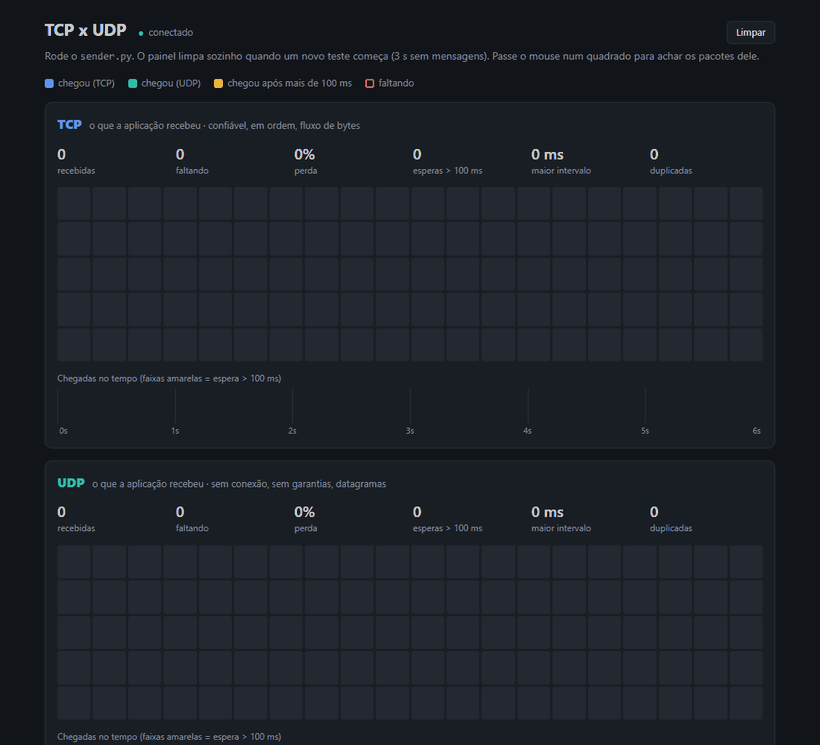

# tcp-udp-example

Projeto visual de estudo para leitura e entendimento dos Protocolos TCP e UDP.

## Objetivo

Entender as principais diferenças entre os protocolos TCP e UDP e como operam.
O projeto funciona de forma simples, apenas para elucidar como funcionam ambos os protocolos quando ocorre perda de dados e retransmissão, auxiliando no entendimento teórico.



## Estrutura

| Arquivo | Onde roda | O que faz |
|---|---|---|
| `sender.py` | VM (Linux) | Envia 100 mensagens numeradas, uma a cada 50 ms, por TCP e UDP ao mesmo tempo (uma thread por protocolo). |
| `receiver.py` | PC (Windows) | Escuta TCP na porta 5001 e UDP na 5002 e imprime número da mensagem e intervalo desde a anterior. |
| `dashboard.py` | PC | Roda o `receiver.py` em laço, captura os pacotes com o `tshark` e serve o painel em `http://localhost:8000`. |
| `dashboard.html` | navegador | Painel: grade de 100 blocos por protocolo, linha do tempo das chegadas e lista de pacotes da rede. |

Cada mensagem tem 12 bytes, montados com `struct.pack("!IQ", seq, time.time_ns())`: 4 bytes de número de sequência e 8 de horário de envio, na ordem de bytes da rede.

Como o TCP entrega um fluxo de bytes sem fronteiras, o receptor usa `recv_exact()` para ler exatamente 12 bytes por mensagem. No UDP, cada `recvfrom()` já traz um datagrama inteiro.

## Ambiente

- **Remetente:** VM Linux no homelab (`192.168.15.21`, interface `ens18`), com Python 3 e `tc` (pacote `iproute2`).
- **Receptor:** PC Windows na mesma rede (`192.168.15.2`), com Python 3.12 e Wireshark (o `tshark` vem junto).
- **Portas:** 5001/TCP e 5002/UDP, liberadas na entrada do firewall do Windows:

  ```powershell
  New-NetFirewallRule -DisplayName "tcp-udp-example TCP" -Direction Inbound -Protocol TCP -LocalPort 5001 -Action Allow
  New-NetFirewallRule -DisplayName "tcp-udp-example UDP" -Direction Inbound -Protocol UDP -LocalPort 5002 -Action Allow
  ```

São usadas duas máquinas de verdade de propósito: em `localhost` o tráfego não passa pela placa de rede, então não aparecem quadros Ethernet e não dá para simular perda.

O remetente fica na VM porque o `tc netem` só afeta o tráfego que **sai** da máquina, e o Windows não tem `netem`.

## Como rodar

1. No PC, com o painel:

   ```powershell
   python dashboard.py
   ```

   Abra `http://localhost:8000`. Se não quiser o painel, `python receiver.py` faz só a recepção no terminal.

   O `dashboard.py` captura na placa chamada `Ethernet` (veja `CAPTURE_INTERFACE`). Para listar os nomes das placas: `tshark -D`.

2. Na VM, com `IP_RECEIVER` do `sender.py` apontando para o PC:

   ```bash
   python3 sender.py
   ```

O painel limpa sozinho quando um novo teste começa (3 s sem mensagens), então basta rodar o `sender.py` de novo para outra rodada.

## Simulando falhas na rede (tc netem)

Todos os comandos rodam na VM, na interface `ens18`:

```bash
sudo tc qdisc add dev ens18 root netem loss 10%            # liga 10% de perda
sudo tc qdisc change dev ens18 root netem loss 30%         # troca a configuração
sudo tc qdisc change dev ens18 root netem delay 100ms 50ms # atraso com variação
sudo tc qdisc change dev ens18 root netem duplicate 5%     # duplica pacotes
tc -s qdisc show dev ens18                                 # mostra a configuração e quantos pacotes foram descartados
sudo tc qdisc del dev ens18 root                           # desliga
```

Enquanto o `netem` está ligado, o SSH da VM também sofre a perda e fica travando: é o TCP do próprio SSH retransmitindo.

Para acompanhar as retransmissões fora do painel:

- **No Wireshark do PC**, filtre por `tcp.analysis.retransmission`, `tcp.analysis.duplicate_ack` ou `tcp.analysis.lost_segment`.
- **Na VM**, rode `nstat -az TcpRetransSegs` antes e depois de um teste.

## O que observei

Ao visualizar a lista de pacotes de rede, é notável como o protocolo TCP precisa fazer mais comunicação entre as partes do que o protocolo UDP.
Como o experimento foi realizado na mesma rede, não deu para ver a diferença de velocidade entre ambos. Porém, ao adicionar perda de pacotes no sender, foi possível notar que o intervalo de recebimento do TCP foi muito maior (quase 4x maior em um dos testes), mas o TCP não teve nenhuma perda de dados, devido à retransmissão, enquanto o UDP sofreu todas as perdas.
